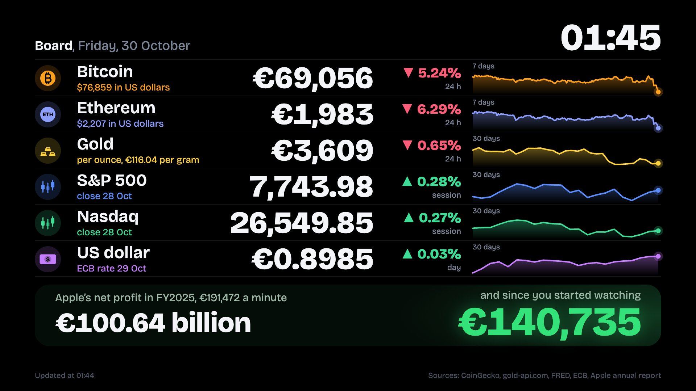
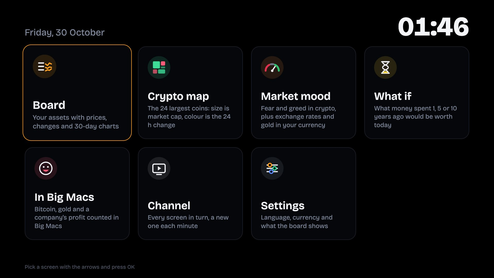
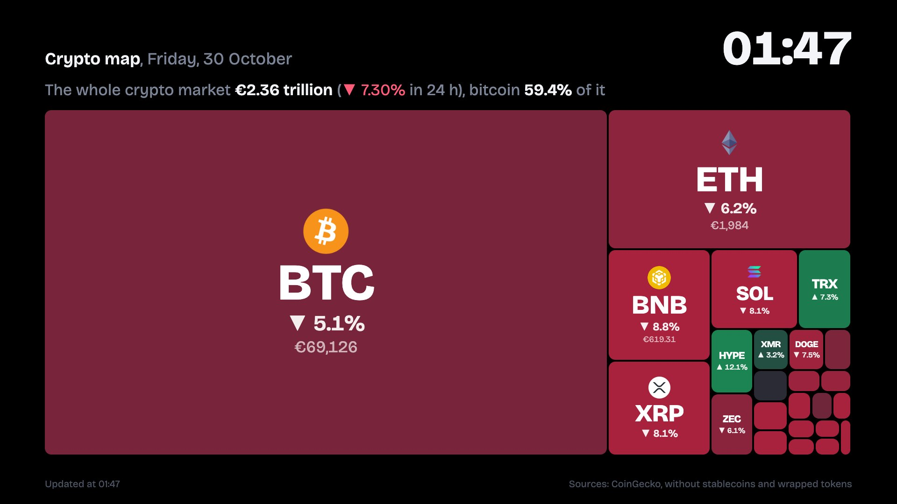
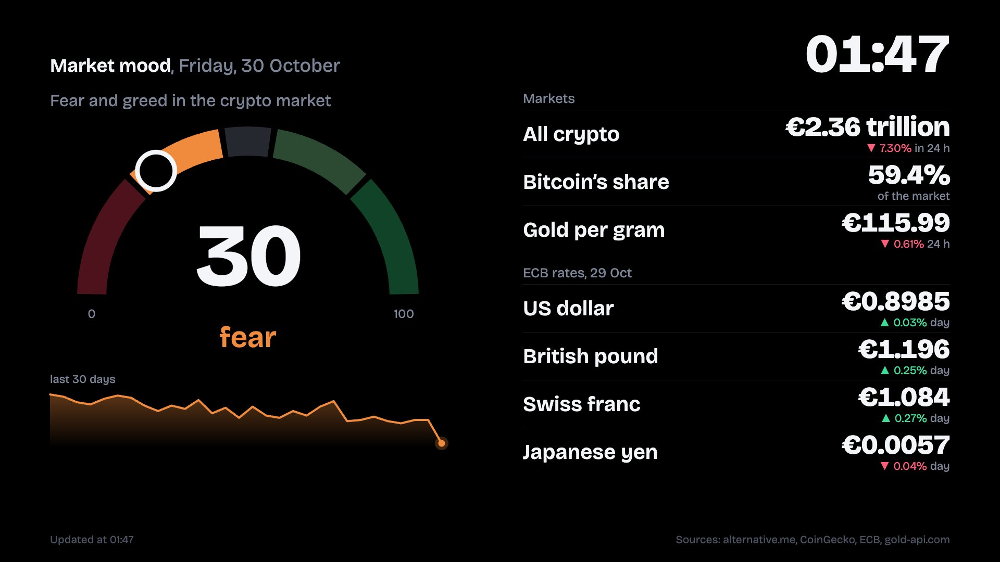
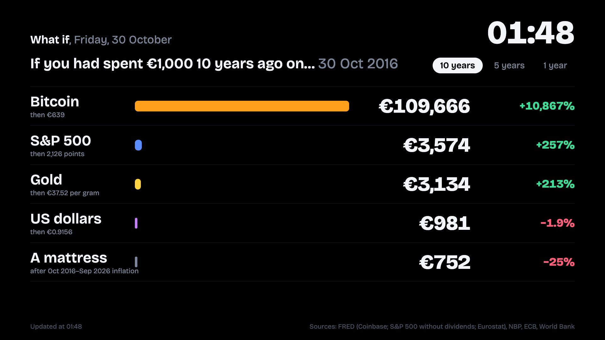
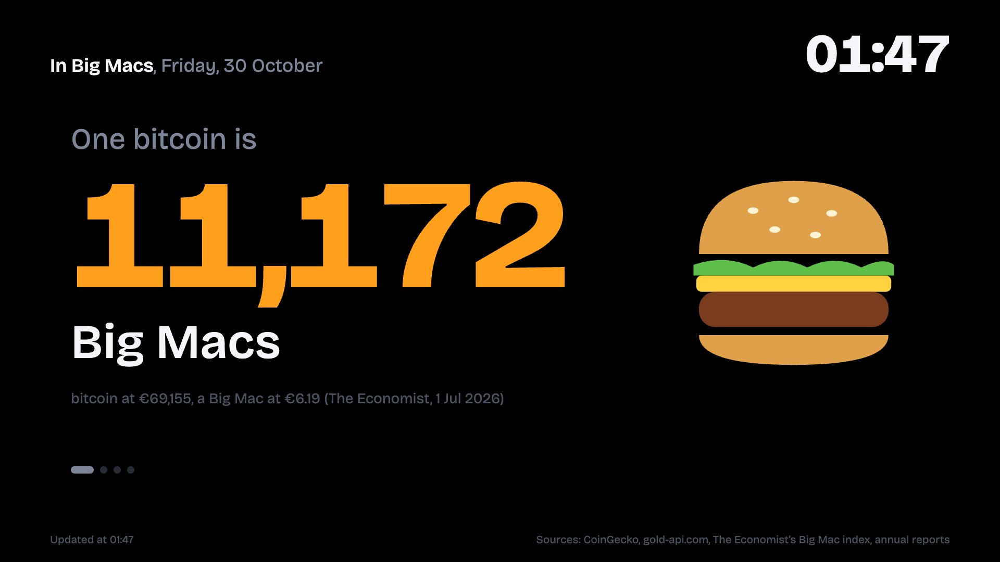
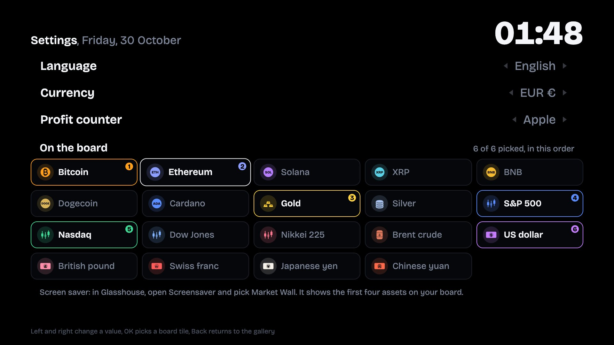

# Market Wall

Live markets on your LG TV: crypto, gold, stock indices and exchange rates, in your language and currency.
A homebrew web app for webOS, driven entirely with the remote, made to sit on a big OLED screen all day.



## Screens

| Screen | What it shows |
| --- | --- |
| **Board** | Up to six assets you pick, each with its price in your currency, the change and a 7 or 30-day chart. Underneath, a counter of how much a big company "earns" while you watch (or turn it off). |
| **Crypto map** | The 24 largest coins as a treemap: size is market cap, colour is the 24 h change. |
| **Market mood** | The crypto Fear & Greed index, the whole crypto market, gold per gram and ECB exchange rates in your currency. |
| **What if** | What 1,000 of your currency spent 1, 5 or 10 years ago on bitcoin, the S&P 500, gold or dollars would be worth today, next to keeping it under the mattress. |
| **In Big Macs** | Bitcoin, gold and the company's profit counted in Big Macs at your country's price (The Economist's Big Mac index). |
| **Channel** | Every screen in turn, a new one each minute. |
| **Settings** | Language, currency, the profit counter and what the board shows. |

<table>
<tr><td></td><td></td></tr>
<tr><td></td><td></td></tr>
<tr><td></td><td></td></tr>
</table>

**Languages:** English and Polish (the Polish version adds kebabs, Fiat Pandas and the XTB profit meme).
**Currencies:** USD, EUR, GBP, CHF, JPY, CAD, AUD, PLN, CZK, HUF, SEK, NOK, DKK, TRY, INR, BRL, MXN, CNY.
On first start the app picks both from the TV's own language and region.

## Remote

- **Gallery:** arrows pick a screen, **OK** opens it, **Back** closes the app.
- **On a screen:** left and right go to the next screen, **Back** returns to the gallery.
- **What if:** up and down change the period.
- **Settings:** up and down move between rows, left and right change a value, **OK** adds or removes a board tile.
- The app reopens the last screen (or the Channel) next time.

## Screen saver

Market Wall also ships a screen saver: a clock and the first four assets from your board, in your language and
currency. It is picked in [Glasshouse](https://github.com/rorygallagher2024/glasshouse): open its
**Screensaver** tab and choose **Market Wall**. It moves to a new spot every minute and nothing on it is full
white.

The screen saver reads the settings the app saves through the Homebrew Channel's root service, so open the app's
Settings once after installing. It needs a TV whose screen saver runs QML (webOS 4 to 9, according to
Glasshouse); on webOS 10 and later Glasshouse doesn't list it.

## Install

Market Wall needs a webOS TV with the [Homebrew Channel](https://github.com/webosbrew/webos-homebrew-channel)
(rooted, or in developer mode) and webOS 5 or later.

Download the `.ipk` from the [latest release](https://github.com/dzienisz/market-wall-webos/releases/latest) and
install it with the Homebrew Channel, or from a computer with
[`ares-install`](https://www.npmjs.com/package/@webos-tools/cli) or
[webOS Dev Manager](https://github.com/webosbrew/dev-manager-desktop).

Tested on an LG OLED55BX3LB (webOS 5.6.2, rooted).

## Data and privacy

Every source is free and needs no key or account. The TV talks to them directly; Market Wall has no server, no
analytics and no tracking. Prices refresh every minute, charts every 30 minutes.

| Data | Source |
| --- | --- |
| Crypto prices, market caps, history | [CoinGecko](https://www.coingecko.com/) public API |
| Gold and silver spot prices | [gold-api.com](https://gold-api.com/) (24 h change and charts from the PAX Gold and Kinesis Silver tokens) |
| S&P 500, Nasdaq, Dow Jones, Nikkei 225, Brent, bitcoin history, euro-area inflation | [FRED](https://fred.stlouisfed.org/), St. Louis Fed |
| Exchange rates | European Central Bank, through [Frankfurter](https://frankfurter.dev/) |
| Gold price history | [Narodowy Bank Polski](https://api.nbp.pl/), converted at the ECB rate of the day |
| Inflation | [World Bank](https://data.worldbank.org/) consumer price index |
| Fear & Greed index | [alternative.me](https://alternative.me/crypto/fear-and-greed-index/) |
| Big Mac prices | [The Economist's Big Mac index](https://github.com/TheEconomist/big-mac-data) |
| Company profits | Annual reports (10-K for US companies), in `src/companies.js` |

Index values are price indices without dividends. None of this is investment advice.

## OLED care

The background is pure black (those pixels are off), the layout shifts by a few pixels every 3 minutes, the crypto
map uses dark colours, and the screen saver moves its whole block every minute.

## Adding a screen

1. Copy `screens/_template.js` to `screens/<name>.js` and fill in the id, colour, icon, strings, HTML, CSS and
   `start`.
2. Add `'<name>'` to `screens/list.js`. The order there is the order in the gallery.

Things to know:

- Fetch through `Data.json(url, ttl)` / `Data.fred(...)` so screens share requests. CoinGecko's free tier rejects
  bursts, so its calls are queued 7 seconds apart.
- Convert prices with `Data.fx()`, which gives `fx.usd(value)` and `fx.from(value, 'PLN')` in the viewer's currency,
  and format them with `Currency.money` / `Currency.auto` / `Currency.big`.
- Put every visible string in the screen's `strings` (English first; it's the fallback) and show them with `t()`.
- Start timers with `F.every` / `F.after`; they stop when the screen is left.
- webOS 5 runs Chromium 68: no `?.`, no `??`, no flex `gap`.
- Installed webOS apps don't enforce CORS, so sources without CORS headers (FRED) work on the TV but not in a
  desktop browser.
- Check a new HTTPS source from the TV itself (`curl -sS -o /dev/null -w "%{http_code}" <url>` over SSH): older
  TVs' certificate stores lack some newer root CAs.

## Adding a language

Every file registers its strings with `I18N.add({ en: {...}, pl: {...} })`. Add your language's block to each
(`src/core.js`, `src/assets.js` and every screen), its plural rule to `I18N.plural` and its day and month names
in `src/i18n.js`, then list it in `I18N.LANGS`. Strings you leave out fall back to English.

## Building

```sh
npm install -g @webos-tools/cli
sh tools/package.sh dist
```

This writes the `.ipk` and the Homebrew Channel manifest to `dist/`. Pushing a tag such as `v1.0.1` (matching
`version` in `appinfo.json`) builds both on GitHub Actions and attaches them to a release.

To try a change on your own TV over SSH:

```sh
scp dist/io.github.dzienisz.marketwall_<version>_all.ipk root@<tv>:/tmp/mw.ipk
ssh -tt root@<tv> 'luna-send -n 1 luna://com.webos.appInstallService/dev/install \
  "{\"id\":\"io.github.dzienisz.marketwall\",\"ipkUrl\":\"/tmp/mw.ipk\",\"subscribe\":true}"'
```

## Credits

Written by Kamil Dzieniszewski with the help of Claude Code, an AI coding tool, and tested on a real TV.
Font: [Bricolage Grotesque](https://github.com/ateliertriay/bricolage) (SIL Open Font License, `fonts/OFL.txt`).
Code: MIT, see `LICENSE`.
